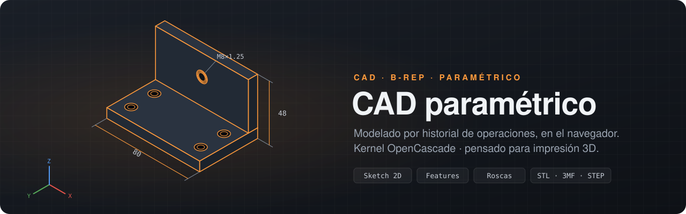
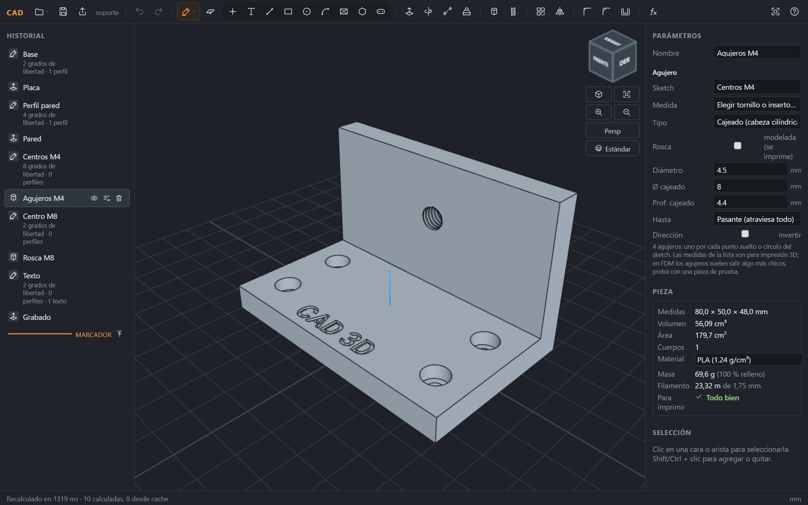
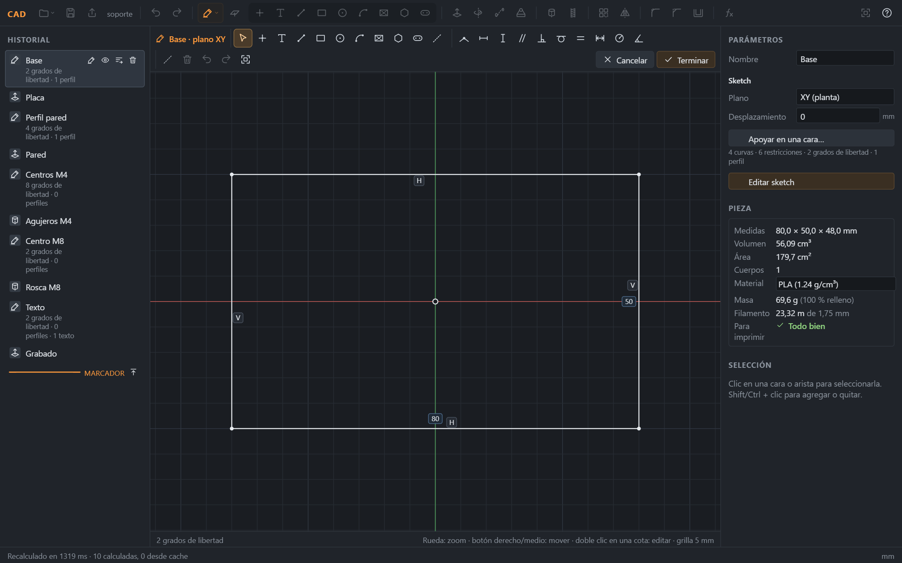
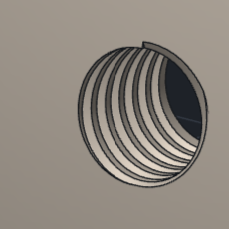
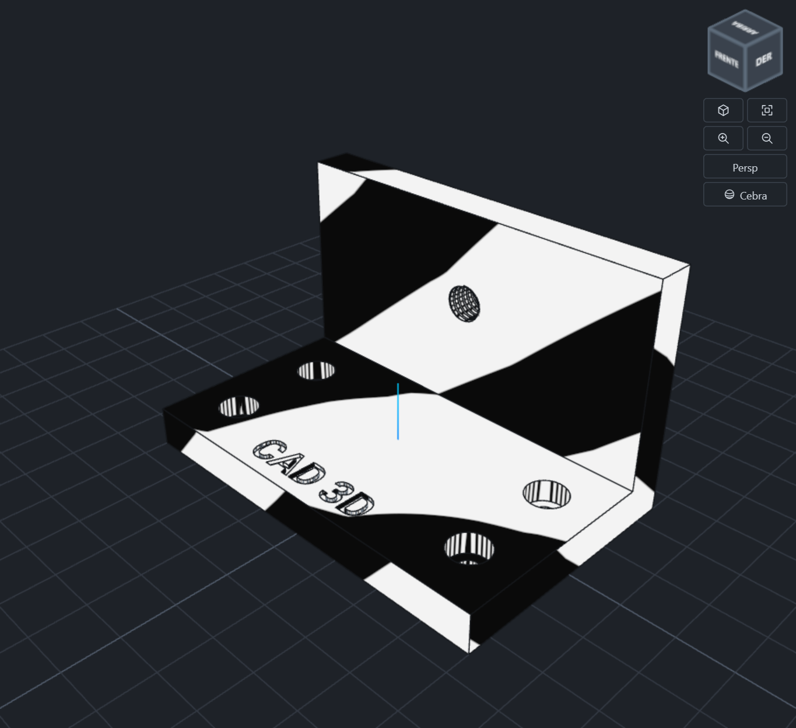
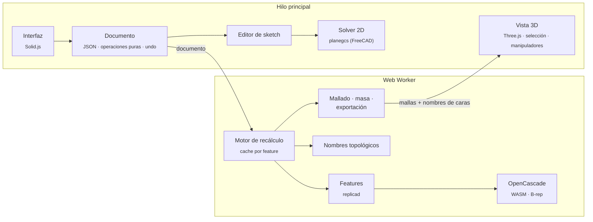

<p align="center">
  
</p>

<p align="center">
  
  
  
  
  
  
</p>

<p align="center">
  <b>Un CAD paramétrico de verdad, sin instalar nada.</b><br>
  Sketches con restricciones, operaciones sólidas sobre un kernel B-rep y un historial que se recalcula solo.
</p>

---

<p align="center">
  
</p>

El modelo se construye como en **Fusion 360** o el **Part Design de FreeCAD**: cada operación queda en el historial con sus parámetros. Si cambiás una medida, el sketch se vuelve a resolver y todo lo que viene después se recalcula, con agujeros, roscas y redondeos que siguen a las caras correctas.

Corre entero en el navegador. La geometría es **B-rep exacta**, hecha con OpenCascade compilado a WebAssembly. No son mallas: la exportación STEP es geometría real, y STL y 3MF se teselan al final.

## Índice

- [Funcionalidades](#funcionalidades)
- [Primeros pasos](#primeros-pasos)
- [Arquitectura](#arquitectura)
- [Detalles técnicos](#detalles-técnicos)
- [Atajos de teclado](#atajos-de-teclado)
- [Licencias](#licencias-de-terceros)

## Funcionalidades

<table>
<tr>
<td width="50%" valign="top">

### ✏️ Sketch 2D con restricciones

- Punto, línea, rectángulo (también desde el centro), círculo, arco, polígono, ranura, **spline**, **curva NURBS** (puntos de control, grado 1 a 5) y **texto**.
- Peine de curvatura para revisar la suavidad de las splines; tangencia de una spline con líneas, arcos u otras splines.
- Herramientas de edición como las de Fusion: **recortar**, **desfase** (paralelo, vinculado al original), **redondeo de esquina**, **simetría** y **patrones** circular y lineal.
- Restricciones geométricas: coincidente, horizontal, vertical, paralela, perpendicular, tangente, igual y simétrica.
- Cotas: distancia, radio y ángulo. Se editan con doble clic.
- Contador de grados de libertad, con un indicador de *totalmente definido*.
- Geometría de construcción y grilla con snap.
- Se dibuja sobre planos base, sobre caras planas del modelo o sobre planos de construcción.

</td>
<td width="50%" valign="top">

</td>
</tr>
<tr>
<td width="50%" valign="top">

</td>
<td width="50%" valign="top">

### 🧱 Operaciones sólidas

| | |
|---|---|
| **Extrusión · Revolución** | Cuerpo nuevo, unir, cortar o intersección; extrusión delgada (paredes y nervios) |
| **Barrido · Solevación** | Perfil por una trayectoria (también splines); solevación entre contornos, puntos, curvas abiertas, caras o **aristas** del modelo (como en Plasticity: superficie o sólido, tangente a las caras vecinas), con trayectoria central o cerrada en anillo |
| **Agujero** | Simple, cajeado o avellanado, con presets de tornillos e insertos |
| **Rosca modelada** | ISO de 60°, interna o externa, imprimible |
| **Redondeo · Chaflán · Vaciado** | Sobre aristas o caras seleccionadas; redondeo de radio variable |
| **Patrón · Simetría** | Lineal, circular o respecto de un plano |
| **Planos de construcción** | Desplazados o girados sobre un eje o una arista |
| **Empujar/tirar** | Modelado directo: la cara plana avanza o retrocede |
| **Desmoldeo** | Inclinar caras respecto de una cara neutra |
| **Combinar · Dividir** | Unir, cortar o intersectar cuerpos; partirlos con un plano |
| **Mover/copiar cuerpos** | Traslación y giro, con o sin copia; flechas X/Y/Z y aro de giro en el modelo |
| **Abombar cara · Parche** | Superficies libres: abombar una cara plana o rellenar un contorno de aristas, como superficie sin espesor o engrosada, opcionalmente tangente a las caras vecinas |
| **Línea 3D** | Unir vértices del modelo con líneas en el espacio (clic en cada vértice; clic en el primero cierra). Una línea que va por una cara la parte en dos (después se puede empujar/tirar cada parte). La curva sigue al modelo si cambian sus cotas y, cerrada, sirve de borde para un parche. **Superficie por vértices** en un paso, y cada tramo se curva arrastrando sus asas en el visor (como los puntos de control de Plasticity), con tangente continua opcional |

</td>
</tr>
<tr>
<td width="50%" valign="top">

### 🔍 Análisis y fabricación

- Sombreados **estándar, arcilla, cromo, cebra y normales**. La cebra muestra la continuidad de las superficies y los redondeos.
- Medición de distancias y ángulos entre caras y aristas.
- Propiedades: volumen, área, masa y **metros de filamento** según el material.
- **Comprobación para imprimir:** sólido válido, malla cerrada, normales hacia afuera y cuerpos sin superponerse.
- Exportación **STL, 3MF y STEP**. Importación **STL/STEP** como **sólido** (cuerpo nuevo, unir, cortar para encastres) o como referencia. Los STL se reparan solos: agujeros, caras dadas vuelta, triángulos repetidos y vértices sin soldar.

</td>
<td width="50%" valign="top">

</td>
</tr>
</table>

### 🕑 Historial paramétrico

- Editar, suprimir, borrar y **retroceder con el marcador**, para ver la pieza en cualquier punto de su historia.
- **Reordenar** las operaciones arrastrándolas. Se controla que ninguna quede antes de algo de lo que depende.
- **Parámetros con nombre y expresiones** (`espesor * 2`, `ancho / 2 - 5`), usables en cualquier campo numérico.
- Deshacer y rehacer instantáneos, y un borrador automático por pestaña (`?pieza=nombre`).
- El documento es un JSON legible (`.cad.json`), validado al abrirlo.

### 📚 Biblioteca de modelos

**Archivo → Biblioteca de modelos…** abre modelos paramétricos listos como proyecto nuevo, con todo el
historial a la vista. Cada medida está en la tabla de parámetros (`fx`): cambiar `largo`, `alto`, el
bisel o el diámetro de las asas regenera el modelo entero. Los sketches quedan totalmente definidos
con cotas que son expresiones de esos parámetros.

| Modelo | Qué tiene |
|---|---|
| **Caja transportadora** | Hard surface: cuerpo octogonal con biseles, junta de tapa con labios, paneles ranurados, asas superiores y laterales, trabas |
| **Caja de seguridad SSC** | Hard surface: aristas redondeadas, junta a media altura, costillas en la tapa (cantidad paramétrica), paneles frontales con escalón central, tapas laterales en relieve con tornillos y asa, patas |

Las plantillas están en `src/templates/` y se escriben con `TemplateBuilder` (parámetros, sketches con
coordenadas como expresiones, extrusiones, simetrías y chaflanes/redondeos que eligen sus aristas sobre
el sólido ya calculado). `tests/templates.test.ts` arma cada una y la regenera con otras medidas.

## Primeros pasos

Requiere **Node.js 20** o más nuevo.

```bash
git clone https://github.com/pablometal1/cad-parametrico.git
cd cad-parametrico
npm install
npm run dev        # http://localhost:5173
```

| Comando | Qué hace |
|---|---|
| `npm run dev` | Servidor de desarrollo con recarga en caliente |
| `npm test` | Suite completa contra OpenCascade real, sin mocks |
| `npm run typecheck` | Comprobación de tipos |
| `npm run build` | Versión estática para publicar, en `dist/` |

Flujo típico:

1. `K` crea un sketch.
2. Se dibuja con `R` o `C`.
3. Se acota y se termina con `Enter`.
4. `Shift+E` lo extruye.

Después se pueden agregar agujeros (`Shift+H`), redondeos (`Shift+F`) y lo que haga falta. Volvé al sketch cuando quieras y cambiá una cota.

## Arquitectura



La vista 3D **solo dibuja**: no tiene geometría propia. Todo lo que se ve sale del kernel, con el nombre de cada cara y arista para seleccionarlas.

| Carpeta | Contenido |
|---|---|
| [`src/document`](src/document) | Modelo del documento, operaciones puras, expresiones, validación de archivos |
| [`src/sketch`](src/sketch) | Sketches: solver, detección de perfiles, texto |
| [`src/kernel`](src/kernel) | Recálculo con cache, features de OpenCascade, nombres topológicos, exportación |
| [`src/viewport`](src/viewport) | Vista 3D, selección, manipuladores, cubo de vistas, sombreados |
| [`src/ui`](src/ui) | Barra de herramientas, historial, paneles, editor de sketch |
| [`tests`](tests) | Tests por operación, con volúmenes comparados contra fórmulas cerradas |

## Detalles técnicos

<details open>
<summary><b>Nombres topológicos persistentes</b></summary>

<br>

El problema clásico de los CAD paramétricos: si un redondeo apunta a "la arista 12" y cambia una medida anterior, la arista 12 pasa a ser otra.

Acá cada cara y arista recibe un nombre que sale de la historia de la operación que la creó, por ejemplo `extrusión:side:<curva del sketch>` o `agujero:wall:<punto>`. Además lleva una huella geométrica que desempata los casos ambiguos. Así las referencias sobreviven a cambios de medidas y de cantidad de elementos.

Si una referencia se pierde de verdad, esa feature queda marcada en error en el historial y el resto del modelo sigue funcionando.

</details>

<details>
<summary><b>Recálculo incremental</b></summary>

<br>

Cada feature guarda en cache su resultado, indexado por una clave encadenada: un hash de su definición más la clave de la anterior. Al editar algo, solo se recalcula desde ese punto. Los sketches y planos que no dependen del sólido no se recalculan aunque cambie lo de antes.

La cache guarda varias versiones por feature, así que deshacer y rehacer es instantáneo. Está medido en un test con una pieza de **100 operaciones**.

</details>

<details>
<summary><b>Roscas imprimibles</b></summary>

<br>

El surco es un perfil ISO de 60°, barrido a lo largo de una hélice en modo binormal (`BRepOffsetAPI_MakePipeShell`). Se resta del sólido.

- **Rosca interna:** el agujero se perfora al diámetro menor y el surco llega al mayor.
- **Rosca externa:** el surco baja del diámetro mayor al menor.
- Hay una holgura configurable para compensar la impresora.
- El largo del surco se limita a las paredes reales del agujero. Un surco mucho más largo que el material hace que la booleana de OCCT falle sin avisar.

</details>

<details>
<summary><b>Importar STL sin coser</b></summary>

<br>

Coser 25.000 triángulos con `BRepBuilderAPI_Sewing` tardaba minutos. En cambio, el lector:

1. suelda los vértices repetidos o casi iguales (tolerancia relativa al tamaño, con grilla de vecinos);
2. repara la malla (`src/kernel/meshRepair.ts`): quita triángulos repetidos, orienta todos los
   triángulos igual que sus vecinos y cierra cada agujero con un abanico desde su centro;
3. crea cada vértice y arista de OpenCascade una sola vez, compartidos entre triángulos vecinos;
4. arma la cáscara a mano.

El historial dice qué se reparó («sólido, reparado: 2 agujeros cerrados»). Si la malla es cerrada, se convierte en sólido y se puede usar en booleanas.

</details>

<details>
<summary><b>Kernel robusto</b></summary>

<br>

- OpenCascade corre en un Web Worker. Si el WASM queda en un estado inválido, el worker se reinicia y el modelo se recalcula solo.
- Los resultados se validan con `BRepCheck`, y los errores de OCCT se traducen a mensajes que dicen qué cambiar.
- La malla que se muestra se adapta al tamaño de la pieza, con un tope de triángulos para que la vista siga fluida.

</details>

## Atajos de teclado

`?` muestra la lista completa dentro de la aplicación.

| General | | Operaciones | |
|---|---|---|---|
| `Ctrl+Z` / `Ctrl+Y` | Deshacer / rehacer | `Shift+E` | Extrusión |
| `Ctrl+S` / `Ctrl+O` | Guardar / abrir | `Shift+R` | Revolución |
| `Ctrl+E` | Exportar | `Shift+B` / `Shift+L` | Barrido / solevación |
| `F` | Encuadrar | `Shift+H` | Agujero |
| `Z` | Cambiar sombreado | `Shift+T` | Rosca |
| `Esc` | Cancelar / quitar selección | `Shift+F` / `Shift+C` | Redondeo / chaflán |
| **Sketch** | | `Shift+V` | Vaciado |
| `K` | Nuevo sketch | `Shift+P` / `Shift+M` | Patrón / simetría |
| `L` `R` `C` `A` `T` | Línea, rectángulo, círculo, arco, texto | `Shift+N` | Plano de construcción |
| `Enter` | Terminar | `Shift+Q` / `Shift+D` | Empujar/tirar / desmoldeo |
| **Editor de sketch** | | `Shift+J` / `Shift+S` | Combinar / dividir |
| `X` `D` `M` | Recortar, desfase, simetría | `Shift+G` | Mover/copiar cuerpos |
| | | `Shift+A` / `Shift+K` | Abombar cara / parche |
| | | `Shift+W` | Línea 3D entre vértices (Enter termina, Backspace quita el último, Esc cancela) |
| | | `Alt+↑` / `Alt+↓` | Mover en el historial |

## Licencias de terceros

| Componente | Licencia |
|---|---|
| OpenCascade (vía `replicad-opencascadejs`) | LGPL-2.1 |
| planegcs | LGPL-2.0 o posterior |
| Roboto | SIL Open Font License 1.1 |
| replicad, Solid.js, Three.js, opentype.js, fflate | MIT o similares |

<p align="center"><sub>Todo en milímetros. Hecho para diseñar piezas que se imprimen.</sub></p>
